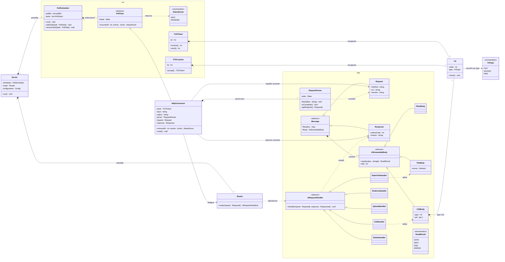

## Préambule

La difficulté de ce projet réside dans son architecture : nous devons faire communiquer le polling, un système profondément event-driven et statefull, avec la sémantique HTTP qui est séquentielle et stateless côté application.

`poll()` ne nous donne pas des requêtes. Il nous signale juste un file descriptor qui peut peut-être avancer.
L'evenement de reception de donnée peut contenir la moitié d’une request line, trois requêtes ou seulement la fin d’un chunk.
Le traitement http, lui, est beaucoup plus simple avec un chemin séquentiel requête -> réponse

Dans notre cas :

```text
HTTP::Request -> une implémentation de ARequestHandler -> HTTP::Response
```

Le but est de pouvoir conjuger l'aspect event-driven du `poll` et la gestion des requêtes tout en ayant un design propre.

L'ideal serait d'avoir un système de coroutine ou de traitement asynchrone. cela dit cpp 98 n'offre rien pour cela.
La solution est de créer une sorte de pseudo scheduler qui execute des taches en parrallèle, mais qui délègue la responsabilité aux tâches de s'arreter et de se relancer là ou elles s'était arrétée. 
La tâche dois donc connaitre son propre état, dois pouvoir s'arrêter et recommencer sans perdre de contexte ou au minimum.
La tâche signale son état au scheduler dans le retour de chaque appel d'une fonction membre `Task::resume()`.
Quand une tâche est terminée, le scheduler detruit la tâche / la supprime de sa liste des tâches.
Le scheduler est le seul propriétaire des tâches. Les ajouts et suppressions de tâches et de fds sont appliqués après le dispatch.

Pour ce faire chaque tâche est en fait ce qu'on appelle une machine à état. elle connait son `state`, peut naviguer entre les états comme elle veut, et décide quand elle est finie.

```cpp
Task::StatusEnum Task::resume()
{
    switch (_state)
    {
        // chaque step peut changer la valeur de _state
        case FIRST_STEP: {
            do_something();
            maybe_go_end();
            maybe_go_second_step();
            return Task::WAIT;
        } break;
        case SECOND_STEP: {
            do_something();
            maybe_go_back_first_step();
            maybe_go_end();
            maybe_create_another_task();
            return Task::WAIT;
        } break;
        case END {
            return Task::FINISHED;
        };
        default: {
            // Unreachable
            assert(false);
        }
    }
}
```

Dans notre cas, le scheduler n'est pas générique : il est spécifique au polling et à la gestion des requètes sur le réseau.
Donc il est plus simple de creer directement une classe `PollScheduler` pour ce faire. Chaque `Task` prendras en paramètre le `pollfd`  et le le client / listener associé, par référence.

Le CGI a besoin que les pipes de retour soient surveillées par `poll()`. La solution est que le `PollScheduler` offre une methode pour reveiller une tache en fonction d'un fd.

```cpp
void PollScheduler::watch(int fd, short events, PollTask* task);
void PollScheduler::unwatch(int fd);
```

Le scheduler ne possède pas les fds surveillés. La destruction d'une tâche supprime toutes ses surveillances.

Le retour des handlers de requêtes sont différents selon les cas :
Par exemple, le `CGIHandler` retourne un etat de la réponse sous la forme d'une pipe lié au process enfant du CGI
Le `FileHandler` retourne un fd ou std::ifstream

Il faut qu'on aie pour le body une notion de streaming, pour que les tâches puisse creer la réponse petit à petit.

Aussi, le parsing des requètes se fait petit à petit.
Les bodies des requêtes sont conservés en mémoire, avec une taille maximale définie par la configuration. Les messages sont non copiables et la réponse possède son body.

>La plupart des implementations ne resolvent simplement jamais ce problème, car difficile à prédire quand on ne connait pas ces contraintes à l'avance. Il en résulte que souvent le traitement CGI se retrouve un peut partout dans toute les classes, ainsi que pour la logique HTTP

## 1. Découpage du projet

Le but est de séparer completement le protocole HTTP et le polling en deux mini-librairies, une pour `http` et une pour le polling, `net`.
Ainsi cela permet d'éviter un graphe de dépendance complexe.
Autrement dit le but est d'avoir des dépendances qui suivent une structure hierarchique en arbre plutôt qu'un graphe ou tout est un peu mélangé.

Dans ce modèle, la gestion du CGI est un simple handler de requete comme nimporte quel autre (une implementation de `ARequestHandler` dans notre cas).

Donc on se retrouve avec les deux librairies et une application (le server web) qui utilisent les differentes fonctionalités pour faire son job.

### Elements clés
#### `net`
- `net::PollScheduler`
- `net::PollTask`
- `net::TCPClient`
- `net::ClientFactory`
- `net::TCPListener` - prend en paramêtre un `ClientFactory`

#### `http`
**Messages**
- `HTTP::Message`
- `HTTP::Request` - hérite de `HTTP::Message` + quelques fields en plus
- `HTTP::Reponse` - hérite de `HTTP::Message` + quelques fields en plus
- `HTTP::AStreamableBody` - utilisé comme le corps des messages http
- `HTTP::PlainBody` - implementation pour une reponse simple
- `HTTP::CGIBody` - implementation pour les corps de réponse de CGI
- `HTTP::FileBody` - implementation pour les corps de réponse des fichiers
- `HTTP::RequestParser` - parsing des requête incrémentale (possède aussi une state machine), dechunking et normalisation
**Logique**
- `HTTP::ARequestHandler` - utilisé par le router pour dispatch les différentes requètes aux differents handlers
- `HTTP::StaticFileHandler` - implementation de `HTTP::ARequestHandler`
- `HTTP::RedirectHandler` - implementation de `HTTP::ARequestHandler`
- `HTTP::UploadHandler` - implementation de `HTTP::ARequestHandler`
- `HTTP::CGIHandler`- implementation de `HTTP::ARequestHandler` 
- `HTTP::DeleteHandler`- implementation de `HTTP::ARequestHandler` 

L'application principale elle se retrouverais dans ces classes :
- `Server` - classes principale possedant le scheduler, les config, le router et handlers
- `Router` - dispatch des requetes dans les differants handlers
- `HttpConnexion` - implementation de `net::PollTask`, gestion d'une requète client
- `HttpClientFactory` - implementation de `net::ClientFactory`, cree des HttpConnextion en leur donnant la config dédiée et le router.

`HttpConnexion` possède un buffer d'entrée, un buffer de sortie et une méthode `reset()` appelée après chaque réponse en keep-alive.

**Configurations (fichiers `.conf`)**
- `Config`
- `ServerConfig`
- `LocationConfig`

Utilitaire :
- `Fd` - RAII wrapper pour les file descripteurs, connais son type de fd (fichier, socket, pipe)

## Cycle de vie de l'application

- Parsing de la config
- création des servers (`TCPListeners`)
- lancement du `PollScheduler` 
- gestion des requetes

## Diagrame

Lexique :
- \*-- signifie un lien `has a` (Composition)
- <|-- signifie un lien `is a` (Heritage)
- ..> signifie une interaction indirecte


