## Préambule

La difficulté de ce projet réside dans son architecture : nous devons faire communiquer le polling, un système profondément event-driven et statefull, avec la sémantique HTTP qui est séquentielle et stateless côté application.

`poll()` ne nous donne pas des requêtes. Il nous signale juste un file descriptor qui peut peut-être avancer.
L'evenement de reception de donnée peut contenir la moitié d’une request line, trois requêtes ou seulement la fin d’un chunk.
Le traitement http, lui, est beaucoup plus simple avec un chemin séquentiel requête -> réponse

Dans notre cas :

```text
HTTP::Request -> une implémentation de ARequestHandler -> HTTP::Response
```

Le but est de pouvoir conjuger l'aspect event-driven du `poll` et la gestion des requêtes tout en ayant un design propre.

L'ideal serait d'avoir un système de coroutine ou de traitement asynchrone. cela dit cpp 98 n'offre rien pour cela.
La solution est de créer une sorte de pseudo scheduler qui execute des taches en parrallèle, mais qui délègue la responsabilité aux tâches de s'arreter et de se relancer là ou elles s'était arrétée. 
La tâche dois donc connaitre son propre état, dois pouvoir s'arrêter et recommencer sans perdre de contexte ou au minimum.
La tâche signale son état au scheduler dans le retour de chaque appel d'une fonction membre `Task::resume()`.
Quand une tâche est terminée, le scheduler detruit la tâche / la supprime de sa liste des tâches.
Le scheduler est le seul propriétaire des tâches. Les ajouts et suppressions de tâches et de fds sont appliqués après le dispatch.

Pour ce faire chaque tâche est en fait ce qu'on appelle une machine à état. elle connait son `state`, peut naviguer entre les états comme elle veut, et décide quand elle est finie.

```cpp
Task::Result Task::resume(short events)
{
    switch (_state)
    {
        // chaque step peut changer la valeur de _state
        case FIRST_STEP: {
            do_something();
            maybe_go_end();
            maybe_go_second_step();
            return Task::Result(Task::WAIT, NULL);
        } break;
        case SECOND_STEP: {
            do_something();
            maybe_go_back_first_step();
            maybe_go_end();
            return Task::Result(Task::WAIT, maybe_create_another_task());
        } break;
        case END {
            return Task::Result(Task::FINISHED, NULL);
        };
        default: {
            // Unreachable
            assert(false);
        }
    }
}
```

Dans notre cas, le scheduler n'est pas générique : il est spécifique au polling et à la gestion des requètes sur le réseau.
Donc il est plus simple de creer directement une classe `PollScheduler` pour ce faire.

Une tâche ne connait pas le scheduler. Elle expose le fd et les événements qu'elle souhaite faire surveiller avec `fd()` et `events()`. Le scheduler relit ces valeurs après chaque `resume()`, ce qui permet à une tâche de changer de fd ou d'événements entre deux étapes.

Le retour `Result` contient un status et éventuellement une tâche enfant. `WAIT + child` transfère la possession de l'enfant au scheduler et le rattache à la tâche courante. `FINISHED + child` est interdit.

Le scheduler ne possède pas les fds surveillés. La destruction d'une tâche supprime toutes ses surveillances. L'annulation d'un parent annule aussi toute sa descendance, sans appeler `on_child_finished()`.

Le retour des handlers de requêtes est différent selon les cas :
- un handler synchrone comme `FileHandler` remplit directement la réponse et retourne `NULL` ;
- un handler asynchrone comme `CGIHandler` retourne une `PollTask` qui remplira la réponse avant d'être terminée.

Le body de la réponse est lu par morceaux avec une taille maximale fournie par l'appelant. Il ne connait ni fd ni polling.

Aussi, le parsing des requètes se fait petit à petit.

>La plupart des implementations ne resolvent simplement jamais ce problème, car difficile à prédire quand on ne connait pas ces contraintes à l'avance. Il en résulte que souvent le traitement CGI se retrouve un peut partout dans toute les classes, ainsi que pour la logique HTTP

## 1. Découpage du projet

Le but est de séparer completement le protocole HTTP et le polling en deux mini-librairies, une pour `http` et une pour le polling, `net`.
Ainsi cela permet d'éviter un graphe de dépendance complexe.
Autrement dit le but est d'avoir des dépendances qui suivent une structure hierarchique en arbre plutôt qu'un graphe ou tout est un peu mélangé.

Dans ce modèle, la gestion du CGI est un simple handler de requete comme nimporte quel autre (une implementation de `ARequestHandler` dans notre cas).

Donc on se retrouve avec les deux librairies et une application (le server web) qui utilisent les differentes fonctionalités pour faire son job.

### Elements clés
#### `net`
- `net::PollScheduler`
- `net::PollTask`
- `net::TCPClient`
- `net::ClientFactory`
- `net::TCPListener` - prend en paramêtre un `ClientFactory`

#### `http`
**Messages**
- `HTTP::Message`
- `HTTP::Request` - hérite de `HTTP::Message` + quelques fields en plus
- `HTTP::Response` - hérite de `HTTP::Message` + status code et body streamable
- `HTTP::AStreamableBody` - utilisé comme le corps des réponses http
- `HTTP::PlainBody` - implementation pour une reponse simple ou un CGI bufferisé
- `HTTP::FileBody` - implementation pour les corps de réponse des fichiers
- `HTTP::RequestParser` - parsing des requête incrémentale (possède aussi une state machine), dechunking et normalisation

L'application principale elle se retrouverais dans ces classes :
- `Server` - classes principale possedant le scheduler, les config, le router et handlers
- `Router` - dispatch des requetes dans les differants handlers
- `ARequestHandler` - utilisé par le router pour dispatch les différentes requètes aux differents handlers
- `FileHandler` - implementation synchrone de `ARequestHandler`
- `RedirectHandler` - implementation de `ARequestHandler`
- `UploadHandler` - implementation de `ARequestHandler`
- `CGIHandler` - implementation de `ARequestHandler`, crée une `CGIResponseTask`
- `DeleteHandler`- implementation de `ARequestHandler`
- `CGIResponseTask` - implementation de `net::PollTask`, gestion d'un processus CGI
- `HttpConnexion` - implementation de `net::PollTask`, gestion d'un client
- `HttpClientFactory` - implementation de `net::ClientFactory`, cree des HttpConnextion en leur donnant la config dédiée et le router.

`HttpConnexion` possède un buffer d'entrée, un buffer de sortie et une méthode `reset()` appelée après chaque réponse en keep-alive. Elle traite une seule requête active à la fois, mais plusieurs requêtes successives pendant sa durée de vie. Après un reset, les octets déjà présents dans le buffer d'entrée sont parsés immédiatement : la connexion n'attend un nouveau `POLLIN` que s'ils ne suffisent pas à construire la requête suivante.

**Configurations (fichiers `.conf`)**
- `Config`
- `ServerConfig`
- `LocationConfig`

Utilitaire :
- `Fd` - RAII wrapper non copiable pour les file descripteurs

## Cycle de vie de l'application

- Parsing de la config
- création des servers (`TCPListeners`)
- lancement du `PollScheduler` 
- gestion des requetes

## 2. Cycle de vie du CGI

`ARequestHandler::handle()` reçoit uniquement une requête et une réponse. Il retourne `NULL` si la réponse est prête, ou une `PollTask*` si un traitement asynchrone est nécessaire. Cela permet de tester chaque handler sans instancier de connexion ou de scheduler.

```cpp
net::PollTask* CGIHandler::handle(const Request& request, Response& response)
{
    return new CGIResponseTask(request, response);
}
```

`HttpConnexion` possède la requête et la réponse courantes. La `CGIResponseTask` reçoit une référence à cette réponse et la remplit directement : il n'y a pas de copie de `Response` et la tâche n'a pas besoin de connaitre la connexion. La connexion retourne ensuite `WAIT + child` au scheduler, qui rattache la tâche à son parent.

Pendant le traitement, la connexion est dans l'état `WAITING_FOR_CHILD`. Elle ne parse pas de nouvelle requête et ne demande pas `POLLIN`, afin d'éviter d'être réveillée en boucle par des données qu'elle ne souhaite pas encore lire. Elle continue cependant à traiter les erreurs et la fermeture du client. Les autres connexions restent traitées normalement par le scheduler.

La sortie du pipe n'est pas un body HTTP : elle contient les headers CGI, une ligne vide, puis le body. Dans la version retenue, `CGIResponseTask` bufferise cette sortie avec une taille maximale, puis :
- parse les headers jusqu'à la première ligne vide ;
- transforme le header `Status` en status code HTTP, avec `200 OK` par défaut ;
- copie les autres headers dans la réponse ;
- place uniquement les octets suivant la ligne vide dans un `PlainBody` ;
- produit une réponse d'erreur si la sortie est invalide ou dépasse la limite ;
- ferme les pipes et récupère le processus avec `waitpid()`.

Il n'y a donc pas de `CGIBody` asynchrone dans cette version. Le CGI n'est pas streamé progressivement vers le client : la réponse est envoyée après la fin de la tâche. Une tâche ne surveille qu'un fd à la fois ; les échanges stdin/stdout doivent être séquencés ou découpés en plusieurs tâches.

Quand `CGIResponseTask` retourne `FINISHED`, la réponse doit être entièrement remplie, y compris en cas d'erreur. Le scheduler retire la surveillance du pipe, appelle `HttpConnexion::on_child_finished()` pendant que la tâche est encore vivante, puis la détruit après le dispatch. La connexion passe simplement à `RESPONSE_READY` et redemande `POLLOUT`. Elle est réveillée avec `resume(0)` pour commencer l'envoi.

Si le client se déconnecte avant la fin, le scheduler annule la connexion et toute sa descendance. Dans ce cas, `on_child_finished()` n'est pas appelé et la tâche libère ses ressources dans son destructeur.

## Diagrame

Lexique :
- \*-- signifie un lien `has a` (Composition)
- <|-- signifie un lien `is a` (Heritage)
- ..> signifie une interaction indirecte

```mermaid
classDiagram
    direction LR

    namespace net {
        class PollScheduler {
            -pollfds : list~pollfd~
            -tasks : list~PollTask~
            +run() void
            +add_listener(listener : TCPListener&) void
            +addTask(task : PollTask, parent : PollTask) void
            +cancelTasksOf(parent : PollTask) void
        }

        class PollTask {
            <<abstract>>
            #state : State
            +resume(events : short)* TaskResult
            +fd()* int
            +events()* short
            +on_child_finished(child : PollTask) void
        }

        class TaskResult {
            +status : StatusEnum
            +child : PollTask
        }

        class StatusEnum {
            <<enumeration>>
            WAIT
            FINISHED
        }

        class TCPClient {
            -fd : Fd
            +receive() int
            +send() int
        }

        class TCPListener {
            -fd : Fd
            -factory : ClientFactory&
            +accept() TCPClient
        }

        class ClientFactory {
            <<abstract>>
            +create(client : TCPClient&)* PollTask
        }
    }

    namespace http {
        class Message {
            <<abstract>>
            #headers : map
        }

        class Request {
            +method : string
            +uri : string
            +version : string
            +body : string
        }

        class Response {
            +statusCode : int
            -body : AStreamableBody
        }

        class AStreamableBody {
            <<abstract>>
            +read(output : string&, maxBytes : size_t)* ReadResult
        }

        class PlainBody
        class FileBody {
            -source : ifstream
        }

        class ReadResult {
            <<enumeration>>
            DATA
            END
            ERROR
        }

        class RequestParser {
            -state : State
            +feed(data : string) void
            +isComplete() bool
            +getRequest() Request&
        }
    }

    class ARequestHandler {
        <<abstract>>
        +handle(request : Request&, response : Response&)* PollTask
    }

    class FileHandler
    class RedirectHandler
    class UploadHandler
    class CGIHandler
    class DeleteHandler
    class CGIResponseTask {
        -pipe : Fd
        -pid : pid_t
        -response : Response&
    }

    class Server {
        -scheduler : PollScheduler
        -router : Router
        -configuration : Config
        -client_factory : HttpClientFactory
        +run() void
    }

    class HttpClientFactory {
        -configuration : Config
        -router : Router
        +create(client : TCPClient&) PollTask
    }

    class Router {
        +route(request : Request&) ARequestHandler&
    }

    class HttpConnexion {
        -client : TCPClient
        -input : string
        -output : string
        -parser : RequestParser
        -request : Request
        -response : Response
        -state : State
        -events : short
        +resume(events : short) TaskResult
        +on_child_finished(child : PollTask) void
        +reset() void
    }

    class Fd {
        -value : int
        +close() void
    }

    PollTask <|-- HttpConnexion
    PollTask <|-- CGIResponseTask
    ClientFactory <|-- HttpClientFactory
    Message <|-- Request
    Message <|-- Response
    AStreamableBody <|-- PlainBody
    AStreamableBody <|-- FileBody
    ARequestHandler <|-- FileHandler
    ARequestHandler <|-- RedirectHandler
    ARequestHandler <|-- UploadHandler
    ARequestHandler <|-- CGIHandler
    ARequestHandler <|-- DeleteHandler

    Server "1" *-- "1" PollScheduler : possède
    Server "1" *-- "1" Router : possède
    Server "1" *-- "1" HttpClientFactory : possède
    Server "1" *-- "*" TCPListener : possède
    PollScheduler "1" *-- "*" PollTask : ordonnance
    PollScheduler ..> TCPListener : surveille
    PollTask ..> TaskResult : retourne
    TaskResult ..> StatusEnum : contient
    TaskResult ..> PollTask : enfant éventuel
    TCPClient "1" *-- "1" Fd : encapsule
    TCPListener "1" *-- "1" Fd : encapsule
    TCPListener --> ClientFactory : utilise
    HttpClientFactory ..> HttpConnexion : crée
    HttpClientFactory --> Router : fournit

    HttpConnexion "1" *-- "1" TCPClient : possède
    HttpConnexion "1" *-- "1" RequestParser : parse avec
    HttpConnexion --> Router : délègue
    HttpConnexion --> Request : requête courante
    HttpConnexion --> Response : réponse courante
    RequestParser ..> Request : construit
    Router ..> ARequestHandler : sélectionne
    ARequestHandler ..> PollTask : retourne éventuellement
    Response "1" *-- "0..1" AStreamableBody : possède
    FileHandler ..> FileBody : utilise
    CGIHandler ..> CGIResponseTask : crée
    CGIResponseTask ..> Response : remplit
    CGIResponseTask "1" *-- "1" Fd : pipe CGI

```


